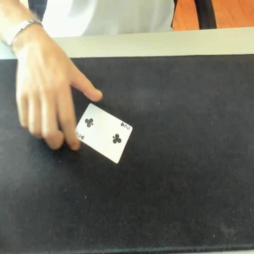
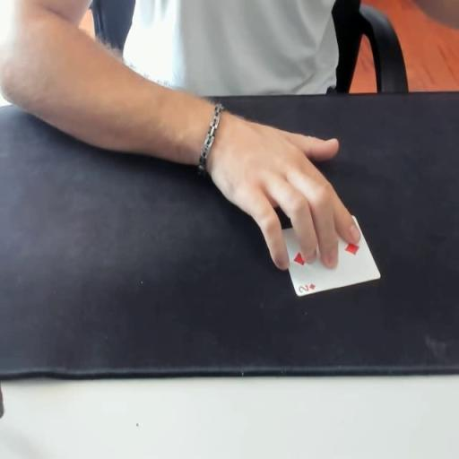
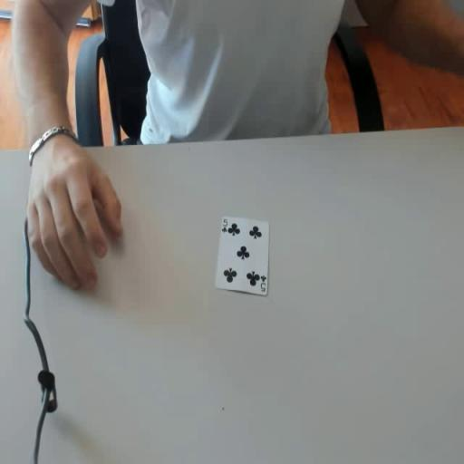
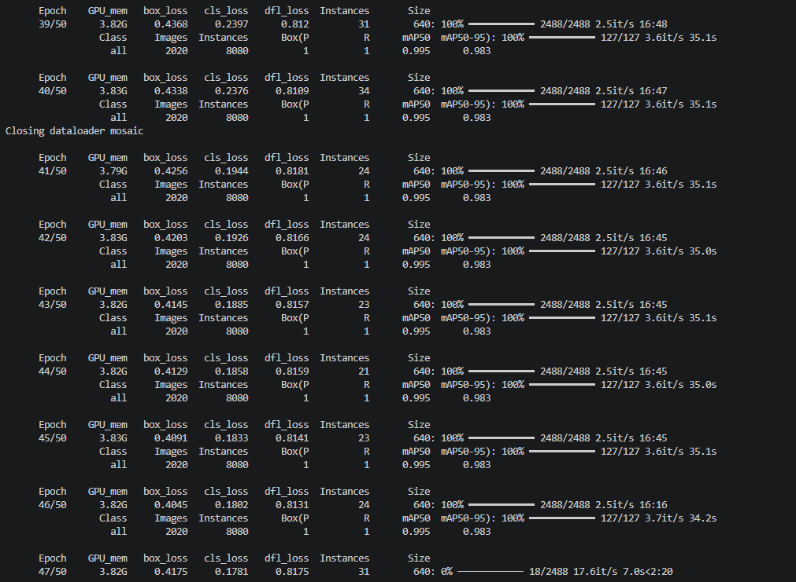

# Blackjack Hi-Lo Counter & Card Tracker

Un progetto di computer vision che riconosce le carte da gioco tramite webcam e usa le rilevazioni per tenere aggiornati il punteggio di una mano di Blackjack e il conteggio Hi-Lo.

Il modello rileva 52 classi — una per ogni carta, senza jolly — e assegna a ciascuna carta un bounding box e un'etichetta.

## Come funziona

Il progetto utilizza **YOLOv8s** tramite [Ultralytics](https://docs.ultralytics.com/), con un modello inizialmente pre-addestrato e poi sottoposto a fine-tuning per riconoscere le carte da gioco.

L'applicazione acquisisce i fotogrammi dalla webcam, traccia gli oggetti rilevati e mostra le predizioni in una finestra OpenCV. Quando l'interfaccia di gioco è attiva, tiene inoltre traccia delle carte viste, dei punteggi di giocatore e banco e del conteggio Hi-Lo.

### Conteggio delle carte

Il valore Hi-Lo usato nel progetto è:

| Carte | Valore |
| --- | ---: |
| 2–6 | +1 |
| 7–9 | 0 |
| 10, J, Q, K, A | -1 |

Gli assi valgono 11 nel calcolo del punteggio della mano; quando il totale supera 21, il loro valore viene ridotto a 1.

## Dataset

Il primo fine-tuning è stato eseguito con un dataset di carte ottenuto tramite [Roboflow Universe](https://universe.roboflow.com/). Per rendere il modello più adatto a situazioni reali, ho poi creato un dataset personale: ho registrato video mentre maneggiavo le carte, estratto dei fotogrammi e fatto generare al modello delle annotazioni iniziali. Ho corretto le classificazioni e i bounding box su Roboflow e applicato tecniche di data augmentation, tra cui rotazioni e conversione in scala di grigi.

Qui sotto ci sono alcuni fotogrammi del **mio dataset**. Mostrano carte riprese in condizioni diverse, con mani, sfondi e orientamenti differenti, oltre a carte parzialmente sovrapposte.

<table>
  <tr>
    <td align="center">
      
      <br><sub>Posizionamento della carta su un tappetino</sub>
    </td>
    <td align="center">
      
      <br><sub>Carta inclinata e mano in movimento</sub>
    </td>
  </tr>
  <tr>
    <td align="center">
      
      <br><sub>Carta su uno sfondo chiaro</sub>
    </td>
    <td align="center">
      
      <br><sub>Carte parzialmente sovrapposte</sub>
    </td>
  </tr>
</table>

## Addestramento e metriche

Lo script [`train.py`](train.py) contiene la configurazione Ultralytics per il training sul dataset in `final_dataset/data.yaml`. Il dataset di training non è incluso nel repository; il percorso del modello di partenza indicato nello script deve essere disponibile localmente.

L'immagine seguente mostra il log di una sessione di training di 50 epoche:



Nel log mostrato, le metriche sul validation set sono **Precision = 1.00**, **Recall = 1.00**, **mAP50 = 0.995** e **mAP50-95 = 0.983**. Il validation set riportato contiene 2.020 immagini e 8.080 istanze. Sono risultati del dataset di validazione: non garantiscono le stesse prestazioni in ogni condizione reale.

- **Precision**: quota delle rilevazioni effettuate che è corretta.
- **Recall**: quota degli oggetti presenti che il modello riesce a rilevare.
- **mAP50**: media della precisione media con soglia IoU pari a 0,50.
- **mAP50-95**: mAP media su soglie IoU da 0,50 a 0,95, con passo 0,05.

Il problema riscontrato dopo questo primo round di fine tuning è quello di avere un modello ottimo a riconsocere solo le carte mostrate nel dataset, ovvero quella tipologia esatta di carte. Per questo motivo ho cercato di affinare il modello facendo un secondo round di fine tuning utilizzando il mio dataset.

## Avvio

1. Crea e attiva un ambiente virtuale, quindi installa le dipendenze:

   ```bash
   python -m venv .venv
   ```

   Su Windows, attivalo con:

   ```powershell
   .\.venv\Scripts\Activate.ps1
   ```

   Installare tutti i pacchetti necessari elencati nel file `requirements.txt`:

   ```bash
   pip install -r requirements.txt
   ```

2. Collega una webcam e, dalla cartella principale del progetto, avvia:

   ```bash
   python main.py
   ```

Ho creato l'applicazione hardware dependent, quindi se è presente una GPU viene utilizzato il file di pesi in `models/weights/best.pt`, se invece il computer è sprovvisto di scheda video, viene utilizzata la CPU caricando la cartella OpenVino: `models/wheights/best_openvino_model/`.

### Tasti dell'interfaccia

| Tasto | Azione |
| --- | --- |
| `p` | Passa alla modalità `play` |
| `s` | Passa dal turno del giocatore a quello del banco e poi al risultato |
| `n` | Inizia una nuova mano, mantenendo il conteggio Hi-Lo |
| `r` | Azzera mano, carte viste e conteggio Hi-Lo |
| `q` | Chiude l'applicazione |

## Struttura del progetto

| File o cartella | Descrizione |
| --- | --- |
| [`main.py`](main.py) | Avvia il tracker e carica il modello |
| [`blackjack.py`](blackjack.py) | Rilevamento webcam, interfaccia, punteggi e conteggio Hi-Lo |
| [`train.py`](train.py) | Configurazione del fine-tuning |
| [`forcpu.py`](forcpu.py) | Esporta il modello in formato OpenVINO |
| [`test.py`](test.py) | Valuta il modello sullo split `test` |
| [`utils/record_video.py`](utils/record_video.py) | Registra video dalla webcam per raccogliere dati |
| [`utils/extract_frames.py`](utils/extract_frames.py) | Estrae fotogrammi dai video registrati |
| [`tests/`](tests/) | Script per provare predizioni e metriche del modello |
| [`models/weights/`](models/weights/) | Modelli usati per inferenza ed esportazione |
| [`img/`](img/) | Immagini del README |
