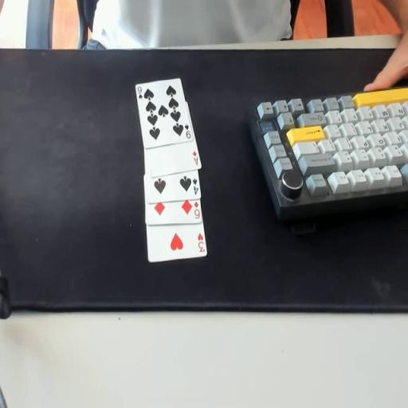
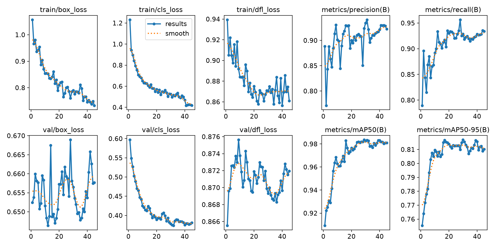
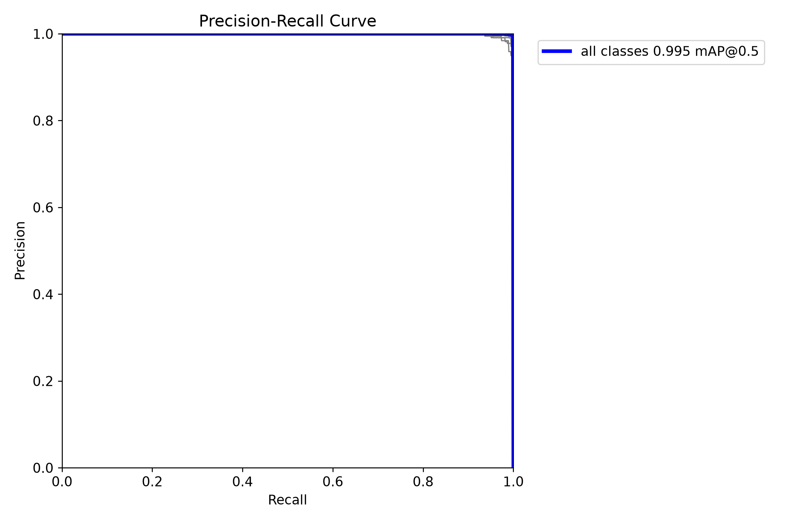
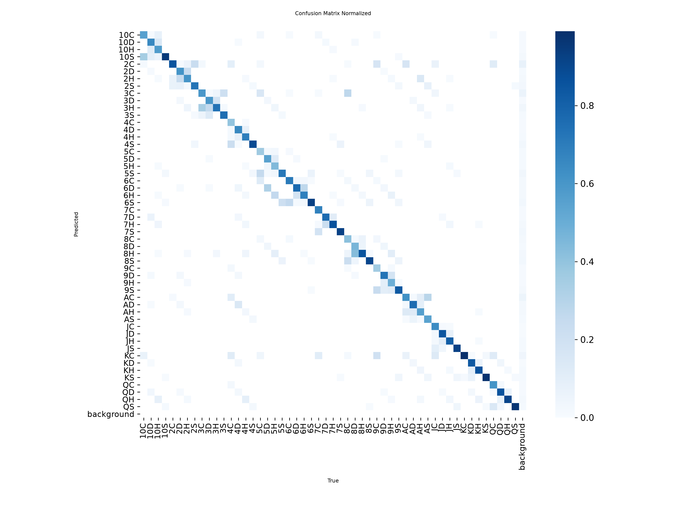

# Blackjack Hi-Lo Counter & Card Tracker

Un progetto di computer vision che riconosce le carte da gioco tramite webcam e usa le rilevazioni per tenere aggiornati il punteggio di una mano di Blackjack e il conteggio Hi-Lo.

Il modello rileva 52 classi, una per ogni carta (senza jolly) e assegna a ciascuna carta un bounding box e un'etichetta.

## Contesto e architettura del modello

In questo progetto è stata utilizzata la versione YOLOv8, sviluppata da [Ultralytics](https://docs.ultralytics.com/).

YOLOv8 è disponibile in diverse taglie (n, s, m, l, x), che rappresentano un compromesso tra velocità di inferenza e accuratezza: modelli più piccoli sono più veloci ma meno precisi, quelli più grandi sono più accurati ma più pesanti computazionalmente. In questo progetto è stata scelta la variante YOLOv8s (small), un buon compromesso tra accuratezza e velocità di inferenza.

Dalla [documentazione ufficiale](https://docs.ultralytics.com/it/models/yolov8) emerge la struttura del modello:
- **Backbone:** si occupa dell'estrazione di feature dall'immagine in input a risoluzioni multiple.
- **Neck:** fonde le feature estratte a diverse scale, in modo che sia gli oggetti piccoli sia quelli grandi abbiano il giusto contesto.
- **Head:** prevede i bounding box e i punteggi delle classi a partire dalle feature fuse dal Neck.

L'applicazione acquisisce i fotogrammi dalla webcam, traccia gli oggetti rilevati e mostra le predizioni in una finestra OpenCV. Quando l'interfaccia di gioco è attiva, tiene inoltre traccia delle carte viste, dei punteggi di giocatore e banco e del conteggio Hi-Lo.

### Regole del Blackjack
L'applicazione utilizza una versione semplificata del gioco del _Blackjack_, contando solamente le carte che vengono richieste dal banco o dal giocatore. I valori delle carte sono i seguenti:

| Carta | Valore |
| --- | --- |
| carta numerica | valore della carta stessa |
| figura | 10 |
| asso | 11 se il punteggio non supera 21, 1 altrimenti |


**N.B**:
In questa applicazione si assume di giocare a Blackjack con un solo mazzo di carte.

### Conteggio delle carte

Il valore Hi-Lo usato nel progetto è:

| Carte | Valore |
| --- | ---: |
| 2–6 | +1 |
| 7–9 | 0 |
| 10, J, Q, K, A | -1 |

L'idea del metodo Hi-Lo è che se il conteggio attuale è molto alto allora è probabile che le prossime carte abbiano valori alti, dando del vantaggio al player e svantaggiando il banco.

## Dataset e Fine-Tuning

## Dataset e Fine-Tuning

Il processo di addestramento del modello è stato iterativo, sviluppato in tre fasi successive, ciascuna ripartita dal checkpoint (`best.pt`) prodotto dalla fase precedente anziché dai pesi generici pre-addestrati su COCO — permettendo al modello di ereditare progressivamente la conoscenza acquisita nelle fasi precedenti.

**Fase 1 — Training di base.** Il primo addestramento è stato eseguito su un dataset di carte massivo ottenuto tramite [Roboflow Universe](https://universe.roboflow.com/), per far apprendere al modello i pattern generali di una carta da gioco (forma dei semi, numeri, struttura dell'indice). Durante le simulazioni reali con webcam è emerso però un problema di overfitting: il modello si era eccessivamente adattato allo stile grafico specifico di quel dataset (semi particolarmente rotondi e piccoli, condizioni di luce uniformi) e faticava a generalizzare sulle carte reali del progetto, specialmente se tenute in mano anziché appoggiate su un piano.

**Fase 2 — Primo fine-tuning.** È stato eseguito un primo fine-tuning aggiungendo alcune fotografie delle carte reali utilizzate nel progetto, incluse alcune tenute in mano, per iniziare a colmare il divario tra le condizioni sintetiche del dataset originale e quelle reali d'uso.

**Fase 3 — Dataset personale esteso.** Poiché i miglioramenti non erano ancora sufficienti, è stato costruito un dataset più ampio, composto interamente da fotogrammi estratti da video girati nelle condizioni reali d'uso (webcam, luce d'ambiente, carte in mano, parzialmente sovrapposte o inclinate). Le annotazioni iniziali sono state generate automaticamente dal modello della fase precedente e poi corrette manualmente su Roboflow; sono state inoltre applicate tecniche di *data augmentation* (rotazioni, variazioni di esposizione, conversione in scala di grigi). Il modello è stato quindi sottoposto a un ultimo ciclo di fine-tuning su questo dataset, riportando un netto miglioramento delle prestazioni nelle condizioni d'uso reali — è il checkpoint finale, usato nell'applicazione.

Qui sotto alcuni fotogrammi del dataset della Fase 3. Mostrano carte riprese in condizioni diverse, con mani, sfondi e orientamenti differenti, oltre a carte parzialmente sovrapposte.

<table>
  <tr>
    <td align="center">
      
      <br><sub>Posizionamento della carta su un tappetino</sub>
    </td>
    <td align="center">
      
      <br><sub>Carta inclinata e mano in movimento</sub>
    </td>
  </tr>
  <tr>
    <td align="center">
      
      <br><sub>Carta su uno sfondo chiaro</sub>
    </td>
    <td align="center">
      
      <br><sub>Carte parzialmente sovrapposte</sub>
    </td>
  </tr>
</table>

### Andamento del training

Il grafico seguente mostra l'andamento di loss e metriche durante la Fase 3 epoca per epoca.



Le curve di training (box loss, classification loss, DFL loss) decrescono in modo regolare, segno che il modello converge correttamente. Le curve di validazione mostrano un andamento più rumoroso: è un comportamento atteso, dal momento che il validation set è molto più piccolo per questo ultimo round di fine tuning.

Le prestazioni finali del modello sono state calcolate su uno split di `test` completamente inedito (dati mai visti dal modello durante il training per evitare overfitting), ottenendo i seguenti risultati matematici:

* **Precision:** 93.4%
* **Recall:** 92.8%
* **mAP50:** 98.2%
* **mAP50-95:** 80.9%

Qui di seguito la **Curva Precision-Recall** e la **Matrice di Confusione Normalizzata**, che dimostrano la robustezza del sistema e l'assenza di scambi frequenti tra classi con pattern simili (es. 8 di Cuori vs 8 di Picche).

<table>
  <tr>
    <td align="center">
      
      <br><sub>Curva Precision-Recall</sub>
    </td>
    <td align="center">
      
      <br><sub>Matrice di Confusione Normalizzata</sub>
    </td>
  </tr>
</table>

## Architettura Tecnica e Tracking

Il sistema non si limita a rilevare le carte fotogramma per fotogramma, ma utilizza un'architettura ibrida per mantenere la coerenza temporale della partita:

* **Hardware-Aware Inference:** L'applicazione rileva dinamicamente l'hardware disponibile. Se trova una GPU NVIDIA (CUDA), carica i pesi standard `.pt` (sfruttando PyTorch). Se avviata su un portatile o un fisso senza GPU dedicata, passa in automatico al modello ottimizzato ed esportato in **OpenVINO** (`best_openvino_model/`), garantendo FPS fluidi sfruttando la CPU. 
* **Object Tracking (BoT-SORT / ByteTrack):** Per evitare che la stessa carta venga conteggiata ripetutamente nei frame successivi (mentre rimane ferma sul tavolo), il sistema aggancia un Tracker ai box di YOLOv8. Assegnando a ogni carta un ID univoco, il modello "ricorda" le carte già processate e aggiorna il punteggio una sola volta.
* **Logica Spaziale:** Per garantire il riconoscimento anche in caso di carte parzialmente sovrapposte, il modello è stato addestrato a rilevare i singoli indici (i numeri/lettere agli angoli). Poiché ogni carta scoperta mostra solitamente due indici, sorgeva il problema del doppio conteggio. Per risolverlo, il sistema calcola la distanza euclidea (tramite teorema di Pitagora) tra i bounding box vicini; se la distanza scende sotto una soglia dinamica calcolata in base alla risoluzione, il codice fonde le rilevazioni identificandole come un'unica carta fisica.

## Avvio

1. Crea e attiva un ambiente virtuale, quindi installa le dipendenze:

   ```bash
   python -m venv .venv
   ```

   Su Windows, attivalo con:

   ```powershell
   .\.venv\Scripts\Activate.ps1
   ```

   Installare tutti i pacchetti necessari elencati nel file `requirements.txt`:

   ```bash
   pip install -r requirements.txt
   ```

2. Collega una webcam e, dalla cartella principale del progetto, avvia:

   ```bash
   python main.py
   ```

### Tasti dell'interfaccia

| Tasto | Azione |
| --- | --- |
| `p` | Passa alla modalità `play` |
| `s` | Passa dal turno del giocatore a quello del banco e poi al risultato |
| `n` | Inizia una nuova mano, mantenendo il conteggio Hi-Lo |
| `r` | Azzera mano, carte viste e conteggio Hi-Lo |
| `q` | Chiude l'applicazione |

## Struttura del progetto

| File o cartella | Descrizione |
| --- | --- |
| [`main.py`](main.py) | Avvia il tracker e carica il modello |
| [`blackjack.py`](blackjack.py) | Rilevamento webcam, interfaccia, punteggi e conteggio Hi-Lo |
| [`train.py`](train.py) | Configurazione del fine-tuning |
| [`forcpu.py`](forcpu.py) | Esporta il modello in formato OpenVINO |
| [`test.py`](test.py) | Valuta il modello sullo split `test` |
| [`utils/record_video.py`](utils/record_video.py) | Registra video dalla webcam per raccogliere dati |
| [`utils/extract_frames.py`](utils/extract_frames.py) | Estrae fotogrammi dai video registrati |
| [`tests/`](tests/) | Script per provare predizioni e metriche del modello |
| [`models/weights/`](models/weights/) | Modelli usati per inferenza ed esportazione |
| [`img/`](img/) | Immagini del README |
